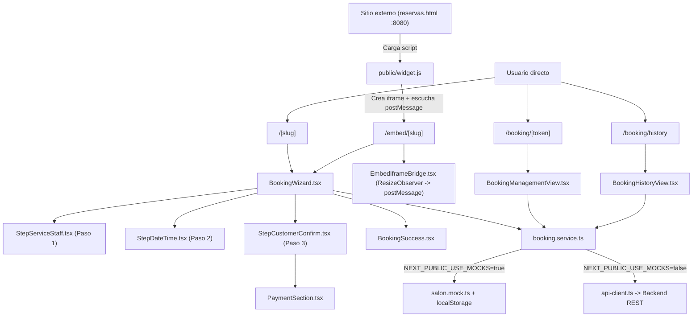

# Kodigo Reservas — Portal de Reservas Multi-tenant

Portal web de reservas de citas para salones de belleza y barberías con arquitectura multi-tenant, flujo mobile-first de 3 pasos, autogestión sin cuenta mediante token y widget embebible con auto-redimensionamiento vía `postMessage`.

---

## URLs de Acceso Rápido

> **Nota:** Para usar las URLs con la IP local (`192.168.0.155`), asegúrate de tener levantado el servidor de Next.js (puerto `3000`) y, para la página externa, el servidor estático (puerto `8080`).

| Vista / Recurso | URL Localhost | URL Red Local (`192.168.0.155`) |
| --- | --- | --- |
| **Portal completo (directo)** | `http://localhost:3000/barberia-studio-sv` | `http://192.168.0.155:3000/barberia-studio-sv` |
| **Widget aislado (`/embed/[slug]`)** | `http://localhost:3000/embed/barberia-studio-sv` | `http://192.168.0.155:3000/embed/barberia-studio-sv` |
| **Página externa con widget embebido** | `http://localhost:8080/reservas.html` | `http://192.168.0.155:8080/reservas.html` |
| **Gestión / cancelación de cita (`/booking/[token]`)** | `http://localhost:3000/booking/tok_test_01` | `http://192.168.0.155:3000/booking/tok_test_01` |
| **Historial de citas del navegador** | `http://localhost:3000/booking/history` | `http://192.168.0.155:3000/booking/history` |
| **Script cargador del widget (`widget.js`)** | `http://localhost:3000/widget.js` | `http://192.168.0.155:3000/widget.js` |

---

## Cómo Levantar el Proyecto

### 1. Frontend (`booking-portal`)

Requisitos previos: **Node.js 20+** y **pnpm 11+** (`pnpm@11.9.0`).

```bash
cd booking-portal
pnpm install
pnpm run dev
```

El script `dev` ejecuta `next dev -H 0.0.0.0`, exponiendo la aplicación en todas las interfaces de red en el puerto `3000` (con `allowedDevOrigins: ["*"]` y cabeceras CORS configuradas en `booking-portal/next.config.ts`).

### 2. Sitio Externo de Prueba (`reservas.html`)

El archivo de prueba externo se encuentra en `/home/capo/Documentos/GraficosPython/reservas.html` y carga el widget desde `http://192.168.0.155:3000/widget.js`.

Para servirlo en un origen distinto (puerto `8080`):

```bash
python3 -m http.server 8080 --directory /home/capo/Documentos/GraficosPython
```

Luego abre en tu navegador: `http://192.168.0.155:8080/reservas.html`.

---

## Stack Tecnológico

- **Framework:** Next.js `16.4.6` (App Router + Turbopack)
- **Lenguaje:** TypeScript (`^5`, modo estricto)
- **Estilos y UI:** Tailwind CSS `4.3.3` (`@tailwindcss/turbopack`), `@base-ui/react`, `shadcn`, `lucide-react`
- **Estado del servidor y caché:** TanStack Query (`@tanstack/react-query` `^5.108.2`)
- **Validación de esquemas:** Zod (`^4.6.7`)
- **Fechas y zonas horarias:** `date-fns` (`^4.4.0`) + `date-fns-tz` (`^3.2.0`)
- **Notificaciones:** `sonner` (`^2.0.8`)

---

## Arquitectura General



---

## Estructura del Proyecto (`booking-portal/`)

```text
booking-portal/
├── .env.local                         # Variables de entorno (modo mock / URL de API)
├── next.config.ts                     # allowedDevOrigins, Turbopack y cabeceras CORS
├── package.json                       # Scripts y dependencias (pnpm)
├── public/
│   └── widget.js                      # Cargador ligero del widget embebible
└── src/
    ├── app/
    │   ├── layout.tsx                 # Layout raíz, fuentes, QueryProvider y Toaster (Sonner)
    │   ├── globals.css                # Tema Tailwind v4 + variables CSS
    │   ├── page.tsx                   # Página raíz
    │   ├── (portal)/[slug]/           # Portal público completo del salón
    │   ├── (embed)/embed/[slug]/      # Vista aislada sin chrome para iframe
    │   └── booking/
    │       ├── [token]/               # Gestión y cancelación de cita sin cuenta
    │       └── history/               # Historial local de citas del usuario
    ├── components/
    │   ├── booking/
    │   │   ├── BookingWizard.tsx      # Orquestador del flujo de 3 pasos
    │   │   ├── StepServiceStaff.tsx   # Paso 1: selección múltiple de servicios y staff
    │   │   ├── StepDateTime.tsx       # Paso 2: calendario 14 días, timezone y horarios
    │   │   ├── StepCustomerConfirm.tsx# Paso 3: formulario Zod, resumen y pago
    │   │   ├── PaymentSection.tsx     # Sección unificada de pago (Local vs Tarjeta/Depósito)
    │   │   ├── BookingSuccess.tsx     # Confirmación y enlace a /booking/[token]
    │   │   ├── BookingManagementView.tsx # Detalle y cancelación de reserva por token
    │   │   └── BookingHistoryView.tsx # Listado de reservas guardadas localmente
    │   ├── embed/
    │   │   └── EmbedIframeBridge.tsx  # Emite BOOKING_WIDGET_RESIZE vía postMessage
    │   ├── layout/
    │   │   └── StickyFooter.tsx       # Barra inferior fija mobile-first
    │   ├── providers/
    │   │   └── query-provider.tsx     # Cliente de TanStack Query
    │   └── ui/                        # Componentes UI base (button, card, input, etc.)
    ├── lib/
    │   ├── api-client.ts              # Cliente fetch tipado con ApiError
    │   ├── timezone.ts                # Utilidades de formato y conversión con date-fns-tz
    │   └── utils.ts                   # Helper cn
    ├── services/
    │   ├── booking.service.ts         # Capa de servicios (mocks vs API real)
    │   └── mocks/salon.mock.ts        # Datos mock + persistencia en localStorage
    └── types/
        └── booking.contracts.ts       # Contratos TypeScript compartidos
```

---

## Estado del Plan de Trabajo por Fases

| Fase | Descripción | Estado |
| --- | --- | --- |
| **Fase 1** | Arquitectura Base y Contratos de Datos (Next.js App Router, TypeScript estricto, Tailwind, Zod, TanStack Query, rutas `/[slug]` y `/embed/[slug]`, capa `services/` con mocks) | Completada |
| **Fase 2** | Flujo Principal Mobile-First en 3 pasos (Single Page Flow, barra de progreso, `StickyFooter`, selección múltiple de servicios y staff, calendario de 14 días + selector de timezone, formulario mínimo + `PaymentSection.tsx` unificada) | Completada |
| **Fase 3** | Persistencia simulada en red local (`-H 0.0.0.0`, CORS en `next.config.ts`, `localStorage` para reservas y cancelaciones) | Completada |
| **Fase 4** | Autogestión sin cuenta (`/booking/[token]` e historial `/booking/history`) | Completada |
| **Fase 5** | Widget embebible (`public/widget.js` + `EmbedIframeBridge.tsx` con `postMessage`) y prueba en sitio externo (`reservas.html`) | Completada |

---

## Integración del Widget Embebible

El script `public/widget.js` permite incrustar el flujo de reservas en cualquier sitio web o CMS sin scroll doble gracias al puente `EmbedIframeBridge.tsx` (`ResizeObserver` + `postMessage` con tipo `BOOKING_WIDGET_RESIZE`).

### Modo declarativo (HTML)

```html
<div
  data-booking-widget
  data-slug="barberia-studio-sv"
  data-base-url="http://192.168.0.155:3000"
></div>
<script src="http://192.168.0.155:3000/widget.js" async></script>
```

### Modo programático (JavaScript)

```js
window.initBookingWidget({
  container: '#mi-contenedor',
  slug: 'barberia-studio-sv',
  baseUrl: 'http://192.168.0.155:3000',
});
```

Eventos emitidos hacia la ventana padre:
- `BOOKING_WIDGET_RESIZE`: ajusta dinámicamente el `height` del `<iframe>` según el contenido.
- `BOOKING_SUCCESS`: dispara el evento DOM `booking:success` en `window` cuando se confirma una reserva.

---

## Variables de Entorno y Datos Mock

Configuración actual en `booking-portal/.env.local`:

```env
# Cambiar a "false" cuando el backend esté desplegado
NEXT_PUBLIC_USE_MOCKS=true

# URL base del backend REST
NEXT_PUBLIC_API_URL=http://localhost:4000/api/public

# Espacio reservado para integración con Stripe
NEXT_PUBLIC_STRIPE_PUBLISHABLE_KEY=pk_test_placeholder
```

- **Salón de prueba (`slug`):** `barberia-studio-sv` (*Studio 503 Barber & Hair*, zona horaria `America/El_Salvador`, política de pago `DEPOSIT` del `25%`).
- **Persistencia simulada:** Las reservas creadas y cancelaciones se almacenan en `localStorage` bajo las claves `kodigo_bookings_store` y `kodigo_booking_tokens`, por lo que sobreviven a recargas (`F5`) y pueden consultarse en `/booking/[token]` o `/booking/history`.

---

## Contratos de Datos y Servicios

Definidos en `booking-portal/src/types/booking.contracts.ts` y consumidos por `booking-portal/src/services/booking.service.ts`:

- `getSalonProfile(slug)` → `SalonProfile`
- `getAvailableSlots({ slug, date, serviceId, staffId })` → `TimeSlot[]`
- `createBooking(payload: CreateBookingPayload)` → `CreateBookingResponse` (incluye `manageToken`, `additionalServiceIds` y `paymentMethod`: `'LOCAL' | 'CARD'`)
- `getBookingByToken(manageToken)` → `BookingDetails`
- `cancelBooking(payload: CancelBookingPayload)` → `CancelBookingResponse`
- `getBookingHistory(salonSlug?)` → `BookingDetails[]`

---

## Comandos Útiles

Ejecutar dentro de `booking-portal/`:

```bash
pnpm run dev               # Servidor de desarrollo en 0.0.0.0:3000
pnpm run build             # Compilación de producción
pnpm run start             # Servidor de producción
pnpm run lint              # Linter (ESLint)
pnpm exec tsc --noEmit     # Verificación de tipos TypeScript
```
