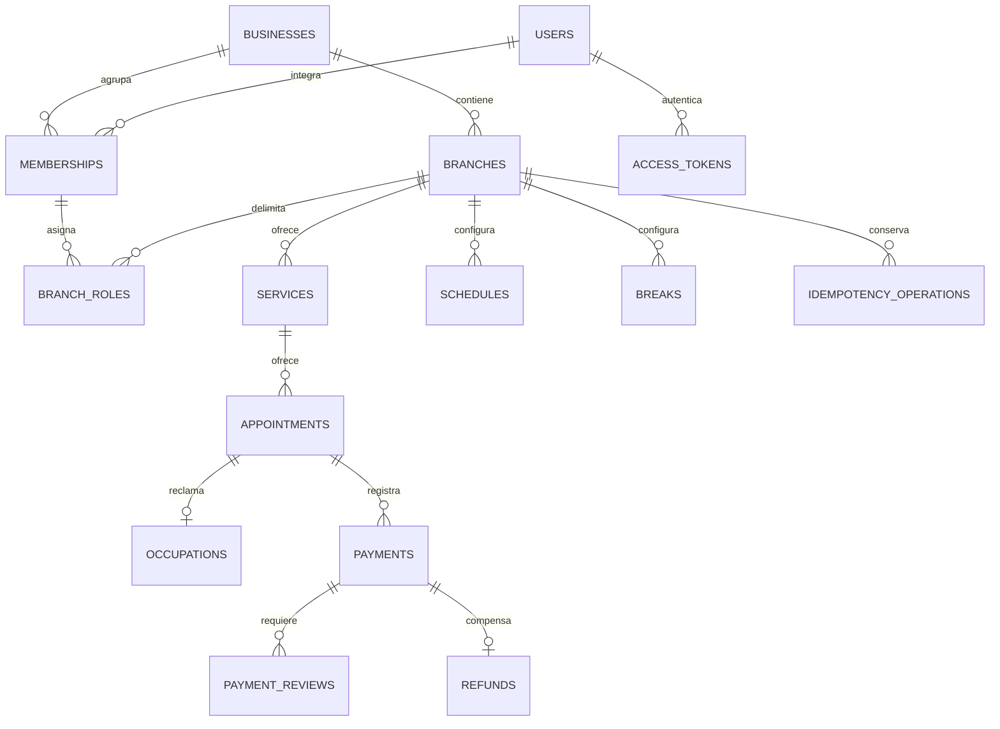

# Arquitectura de reservas

## Modelo relacional

`db/migrations/001_core.sql` define el esquema inicial. Las migraciones se aplican por nombre en una transacción con bloqueo consultivo para evitar ejecuciones simultáneas.



No hay asignación de empleados ni otros recursos. La capacidad es un espacio simultáneo por sucursal. Se conserva el precio en la cita para que una modificación del catálogo afecte únicamente a las reservas futuras.

## Decisión de aislamiento

Se usa un esquema compartido con claves compuestas por negocio y sucursal. Las claves foráneas impiden que una fila de agenda o pagos referencie una entidad de otro ámbito. Las consultas privadas autorizan el rol en el backend y restringen cada lectura o escritura a ambos identificadores. El portal público resuelve el negocio por su identificador y solo permite consultar espacios y crear citas en sucursales de ese negocio.

Esta versión aplica el aislamiento de acceso en la API, junto con integridad referencial en PostgreSQL. Las credenciales SQL de la API pueden acceder a los distintos negocios y deben quedar reservadas al backend. Se difiere RLS hasta contar con una estrategia para establecer el contexto por transacción, gestionar el acceso de plataforma y verificar el comportamiento con conexiones reutilizadas. En despliegues, usa credenciales separadas para migraciones y ejecución, y limita los privilegios de ejecución a las tablas que usa el servicio.

## Matriz de permisos

| Rol | Agenda y completar | Reprogramar e inasistencia | Ingresos, precios y registro de pagos | Autorizar reembolso | Registrar emisión |
|---|---|---|---|---|---|
| Miembro de sucursal | | Sí | | | |
| Empleado | Sí | Sí | | | |
| Recepcionista | Sí | Sí | Sí | | Sí |
| Administrador de sucursal | Sí | Sí | Sí | Sí | |
| Propietario con rol en la sucursal | Sí | Sí | Sí | | |
| Administrador de plataforma | Sí | Sí | Sí | | |

Una membresía activa por negocio y un rol por sucursal conceden acceso. Un usuario puede tener varias membresías y un propietario puede recibir el rol en varias sucursales. El rol de plataforma permite acceder a los negocios sin membresía. Los tokens opacos se guardan como SHA-256 y tienen vencimiento.

El administrador de sucursal invita, desactiva y cambia permisos según la regla de dominio. El alta de identidades, la entrega de invitaciones y la administración de permisos quedan fuera de la API core y requieren aprovisionamiento controlado. Desactivar una membresía revoca el acceso a todo el negocio. Quitar un rol afecta únicamente a su sucursal. Revocar el token termina el acceso asociado a ese token.

La recepcionista puede emitir un reembolso y solo el administrador de sucursal puede autorizarlo. La API registra los pasos por separado y exige autorización previa. El equipo debe ratificar este flujo antes de conectar una pasarela.

## Disponibilidad y transacciones

- Evalúa las fechas en UTC−6 fijo y persiste instantes en `timestamptz`. El horario de sucursal es 08:00–16:00 y el laboral es 08:00–17:00. La prioridad laboral permite ofrecer hasta 16:30 en la configuración inicial. Los domingos se cierran y se aplican los mismos horarios en feriados.
- Cada bloque empieza en un múltiplo de 30 minutos y cubre 20 minutos de servicio y 10 de preparación. Los descansos son intervalos configurables por día de semana. Se ofrece el bloque completo cuando cabe en el horario y no cruza descansos ni ocupaciones activas.
- La ventana es inclusiva entre una hora y un mes de calendario de anticipación. Si el mes siguiente carece del día correspondiente, se usa su último día.
- Una mutación toma `SELECT ... FOR UPDATE` sobre la fila de su sucursal. Después de adquirir el bloqueo, lee la hora de PostgreSQL, libera retenciones vencidas, verifica el permiso y aplica la operación. La clave primaria de `occupations` protege el espacio incluso si una escritura concurrente elude el bloqueo de sucursal. Cambios de horario o descansos realizados por herramientas administrativas también deben tomar el bloqueo de la sucursal y conservar las citas existentes.
- La consulta deja de mostrar una retención como activa al vencer. Las escrituras y un proceso periódico persisten la expiración y liberan la fila de ocupación. Una reprogramación cambia el espacio y la cita dentro de una sola transacción.
- Una clave de idempotencia se aplica por negocio, sucursal, actor y operación. Guarda una huella de los datos y la respuesta dentro de la misma transacción. Una clave que vuelve con datos distintos devuelve conflicto. Un pago también tiene una referencia única por sucursal y receptor. Los reembolsos tienen un único registro por pago.

## Decisiones de negocio pendientes

- **Confirmación y retención.** La API confirma al enviar el formulario. En modalidad en línea, la cita confirmada ocupa el espacio con retención de 15 minutos hasta que se registre un pago válido. En el local, la cita queda confirmada sin retención. El estado pendiente existe en el modelo para flujos que requieran confirmación posterior. El equipo debe validar esta interpretación.
- **Reprogramación.** Se permite un cambio a una hora posterior a la original, hasta 48 horas desde el inicio original y dentro de la ventana general. El equipo debe ratificar esa referencia temporal. El registro de inasistencia libera inmediatamente el espacio.
- **Cancelación.** El plazo sigue abierto. El esquema contempla el estado cancelado y la API carece de una operación pública de cancelación hasta que se defina la regla.
- **Pagos.** Se registra el importe completo, sin anticipo, para la sucursal o la plataforma. Los pagos pendientes o fallidos aparecen en la cola y pueden resolverse con un registro pagado en efectivo usando la misma referencia. Los pagos tardíos y las confirmaciones duplicadas van a revisión manual. Si hubo un cobro duplicado, el administrador autoriza la devolución y la recepcionista registra su emisión. El registro de pagos y devoluciones es operativo. La integración con una pasarela, la recepción autenticada de eventos y la ejecución externa de transferencias quedan pendientes.

## API

Las rutas administrativas requieren `Authorization: Bearer <token>`. Las operaciones POST requieren `Idempotency-Key` de 16 a 128 caracteres alfanuméricos, guiones o guiones bajos. Genera una clave aleatoria por operación y reutilízala en los reintentos de esa misma operación.

| Método y ruta | Entrada principal | Resultado |
|---|---|---|
| GET `/negocios/:slug/sucursales/:branchId/disponibilidad` | `date` en YYYY-MM-DD y `serviceId` | Lista `slots` con `time` local y `startsAt` en ISO 8601. |
| POST `/negocios/:slug/sucursales/:branchId/reservas` | `firstName`, `lastName`, `serviceId`, `startsAt` y `paymentMode` opcional (`in_person`, `online`) | 201 con identificador, estado, inicio y vencimiento si aplica. |
| GET `/admin/negocios/:businessId/sucursales/:branchId/agenda` | `date` en YYYY-MM-DD | Citas de la sucursal para ese día. |
| POST `/admin/negocios/:businessId/sucursales/:branchId/reservas/:appointmentId/reprogramacion` | Nuevo `startsAt` | Cita actualizada. |
| POST `/admin/negocios/:businessId/sucursales/:branchId/reservas/:appointmentId/inasistencia` o `/completar` | Sin cuerpo | Identificador y estado nuevo. |
| POST `/admin/negocios/:businessId/sucursales/:branchId/reservas/:appointmentId/pagos` | `reference`, `recipient` (`branch`, `platform`), `status` (`pending`, `failed`, `paid`), `amountMinor`, `method` (`external`, `cash`) | Identificador, estado y marca de revisión. |
| GET `/admin/negocios/:businessId/sucursales/:branchId/pagos/revisiones` | Sin cuerpo | Incidencias de pago pendientes de revisión. |
| POST `/admin/negocios/:businessId/sucursales/:branchId/pagos/:paymentId/reembolso/autorizar` o `/emitir` | Sin cuerpo | Identificador del reembolso y usuarios que actuaron. |
| PATCH `/admin/negocios/:businessId/sucursales/:branchId/servicios/:serviceId/precio` | `priceMinor` | Identificador y precio actualizado. |
| GET `/admin/negocios/:businessId/sucursales/:branchId/ingresos` | Sin cuerpo | Importes brutos y reembolsados por receptor. |

Los errores se devuelven como `{ "error": "mensaje" }`. Los códigos principales son 400 para entrada inválida, 401 para autenticación, 403 para permisos, 404 para recurso ausente y 409 para conflictos de disponibilidad, estado o idempotencia.

## Datos iniciales

Ejecuta este ejemplo una vez en una base de desarrollo después de migrar. Guarda los identificadores devueltos para consultar la API.

```sql
WITH negocio AS (
  INSERT INTO businesses (slug) VALUES ('mibarberia503') RETURNING id
), sucursal AS (
  INSERT INTO branches (business_id, name)
  SELECT id, 'Centro' FROM negocio RETURNING business_id, id
)
INSERT INTO services (business_id, branch_id, name, price_minor)
SELECT business_id, id, 'Corte', 1000 FROM sucursal
RETURNING business_id, branch_id, id AS service_id;
```

Para probar rutas administrativas, crea un usuario en `users`, su membresía en `memberships` y su rol en `branch_roles`. Genera 32 bytes aleatorios codificados en base64url y guarda el SHA-256 binario en `access_tokens.digest` junto con el usuario y una fecha de vencimiento. Usa el valor original como token.

## Revisión técnica

Usa ramas `feat/<descripcion>`, `fix/<descripcion>` o `docs/<descripcion>` y commits como `fix(reservas): liberar espacio al expirar`. Incluye migraciones, decisiones de dominio y resultados de lint, tipos y pruebas cuando correspondan. Los PR que cambian aislamiento, permisos o transacciones de reserva requieren revisión del responsable de base de datos, con pruebas de integración en PostgreSQL para los invariantes afectados.
