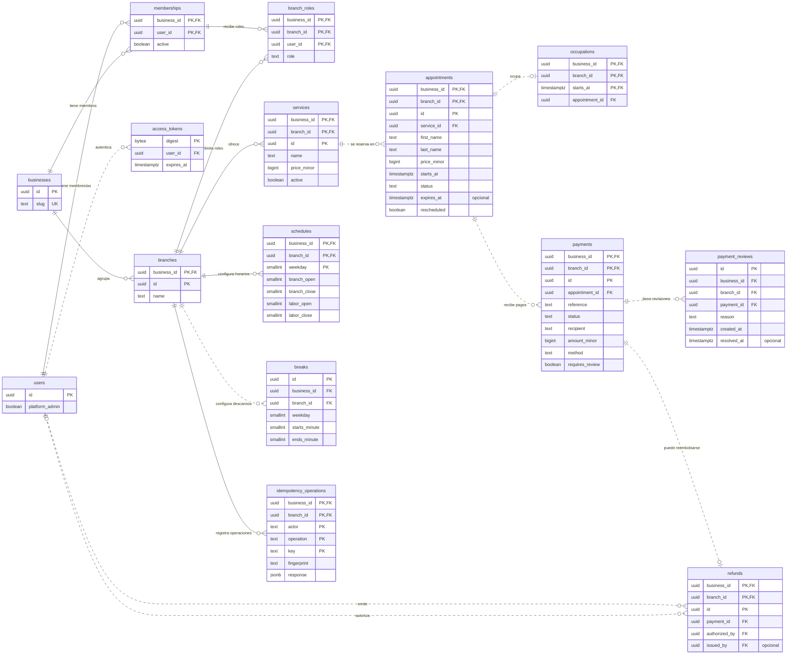

# Arquitectura de reservas

## Modelo relacional

`db/migrations/001_core.sql` define el esquema inicial. Las migraciones se aplican por nombre en una transacción con bloqueo consultivo para evitar ejecuciones simultáneas.

### Diagrama entidad-relación

Cada entidad muestra los campos y tipos de PostgreSQL. **PK** indica clave primaria, **FK** indica clave foránea y **UK** indica una columna única. Los campos marcados como «opcional» admiten NULL. Una línea continua indica una relación identificadora y una línea discontinua indica que la FK queda total o parcialmente fuera de la PK de la tabla hija.



### Claves y restricciones por tabla

Las columnas agrupadas entre paréntesis forman una sola restricción. En cada FK compuesta, las columnas se corresponden por posición con las de la tabla referenciada.

| Tabla | Clave primaria | Claves foráneas | Unicidad adicional |
|---|---|---|---|
| `businesses` | `(id)` | — | `(slug)` |
| `branches` | `(business_id, id)` | `(business_id)` → `businesses(id)` | — |
| `users` | `(id)` | — | — |
| `access_tokens` | `(digest)` | `(user_id)` → `users(id)` | — |
| `memberships` | `(business_id, user_id)` | `(business_id)` → `businesses(id)`<br>`(user_id)` → `users(id)` | — |
| `branch_roles` | `(business_id, branch_id, user_id)` | `(business_id, branch_id)` → `branches(business_id, id)`<br>`(business_id, user_id)` → `memberships(business_id, user_id)` | — |
| `services` | `(business_id, branch_id, id)` | `(business_id, branch_id)` → `branches(business_id, id)` | — |
| `schedules` | `(business_id, branch_id, weekday)` | `(business_id, branch_id)` → `branches(business_id, id)` | — |
| `breaks` | `(id)` | `(business_id, branch_id)` → `branches(business_id, id)` | — |
| `appointments` | `(business_id, branch_id, id)` | `(business_id, branch_id, service_id)` → `services(business_id, branch_id, id)` | `(business_id, branch_id, id, starts_at)` |
| `occupations` | `(business_id, branch_id, starts_at)` | `(business_id, branch_id, appointment_id, starts_at)` → `appointments(business_id, branch_id, id, starts_at)` | `(business_id, branch_id, appointment_id)` |
| `payments` | `(business_id, branch_id, id)` | `(business_id, branch_id, appointment_id)` → `appointments(business_id, branch_id, id)` | `(business_id, branch_id, recipient, reference)` |
| `payment_reviews` | `(id)` | `(business_id, branch_id, payment_id)` → `payments(business_id, branch_id, id)` | `(business_id, branch_id, payment_id, reason)` |
| `refunds` | `(business_id, branch_id, id)` | `(authorized_by)` → `users(id)`<br>`(issued_by)` → `users(id)`<br>`(business_id, branch_id, payment_id)` → `payments(business_id, branch_id, id)` | `(business_id, branch_id, payment_id)` |
| `idempotency_operations` | `(business_id, branch_id, actor, operation, key)` | `(business_id, branch_id)` → `branches(business_id, id)` | — |

- `occupations` permite una sola ocupación por sucursal e instante. Su FK de cuatro columnas exige que el inicio coincida con el de la cita referenciada.
- `schedules` y `breaks` aceptan días del 1 al 6, de lunes a sábado. Las horas se guardan como minutos desde medianoche.
- `schema_migrations` es una tabla interna del ejecutor de migraciones. Contiene el campo `name text` como PK y carece de relaciones con las tablas del dominio.

No hay asignación de empleados ni otros recursos. La capacidad es un espacio simultáneo por sucursal. Se conserva el precio en la cita para que una modificación del catálogo afecte únicamente a las reservas futuras.

## Decisión de aislamiento

Se usa un esquema compartido con claves compuestas por negocio y sucursal. Las claves foráneas impiden que una fila de agenda o pagos referencie una entidad de otro ámbito. Las consultas privadas autorizan el rol en el backend y restringen cada lectura o escritura a ambos identificadores. El portal público resuelve el negocio por su identificador y solo permite consultar espacios y crear citas en sucursales de ese negocio.

Esta versión aplica el aislamiento de acceso en la API, junto con integridad referencial en PostgreSQL. Las credenciales SQL de la API pueden acceder a los distintos negocios y deben quedar reservadas al backend. Se difiere RLS hasta contar con una estrategia para establecer el contexto por transacción, gestionar el acceso de plataforma y verificar el comportamiento con conexiones reutilizadas. En despliegues, usa credenciales separadas para migraciones y ejecución, y limita los privilegios de ejecución a las tablas que usa el servicio.

## Matriz de permisos

| Rol | Agenda y completar | Reprogramar e inasistencia | Ingresos, precios y registro de pagos | Autorizar reembolso | Registrar emisión |
|---|---|---|---|---|---|
| Miembro de sucursal | | Sí | | | |
| Empleado | Sí | Sí | | | |
| Recepcionista | Sí | Sí | Sí | | Sí |
| Administrador de sucursal | Sí | Sí | Sí | Sí | |
| Propietario con rol en la sucursal | Sí | Sí | Sí | | |
| Administrador de plataforma | Sí | Sí | Sí | | |

Una membresía activa por negocio y un rol por sucursal conceden acceso. Un usuario puede tener varias membresías y un propietario puede recibir el rol en varias sucursales. El rol de plataforma permite acceder a los negocios sin membresía. Los tokens opacos se guardan como SHA-256 y tienen vencimiento.

El administrador de sucursal invita, desactiva y cambia permisos según la regla de dominio. El alta de identidades, la entrega de invitaciones y la administración de permisos quedan fuera de la API core y requieren aprovisionamiento controlado. Desactivar una membresía revoca el acceso a todo el negocio. Quitar un rol afecta únicamente a su sucursal. Revocar el token termina el acceso asociado a ese token.

El administrador de sucursal autoriza el reembolso y la recepcionista lo emite en el sistema. La API registra ambos pasos por separado y exige autorización previa.

## Disponibilidad y transacciones

- Evalúa las fechas en UTC−6 fijo y persiste instantes en `timestamptz`. El horario de sucursal es 08:00–16:00 y el laboral es 08:00–17:00. La prioridad laboral permite ofrecer hasta 16:30 en la configuración inicial. Los domingos se cierran y se aplican los mismos horarios en feriados.
- Cada bloque empieza en un múltiplo de 30 minutos y cubre 20 minutos de servicio y 10 de preparación. Los descansos son intervalos configurables por día de semana. Se ofrece el bloque completo cuando cabe en el horario y no cruza descansos ni ocupaciones activas.
- La ventana es inclusiva entre una hora y un mes de calendario de anticipación. Si el mes siguiente carece del día correspondiente, se usa su último día.
- Una mutación toma `SELECT ... FOR UPDATE` sobre la fila de su sucursal. Después de adquirir el bloqueo, lee la hora de PostgreSQL, libera retenciones vencidas, verifica el permiso y aplica la operación. La clave primaria de `occupations` protege el espacio incluso si una escritura concurrente elude el bloqueo de sucursal. Cambios de horario o descansos realizados por herramientas administrativas también deben tomar el bloqueo de la sucursal y conservar las citas existentes.
- La consulta deja de mostrar una retención como activa al vencer. Las escrituras y un proceso periódico persisten la expiración y liberan la fila de ocupación. Una reprogramación cambia el espacio y la cita dentro de una sola transacción.
- Una clave de idempotencia se aplica por negocio, sucursal, actor y operación. Guarda una huella de los datos y la respuesta dentro de la misma transacción. Una clave que vuelve con datos distintos devuelve conflicto. Un pago también tiene una referencia única por sucursal y receptor. Los reembolsos tienen un único registro por pago.

## Decisiones de negocio pendientes

- **Confirmación y retención.** La API confirma al enviar el formulario. En modalidad en línea, la cita confirmada ocupa el espacio con retención de 15 minutos hasta que se registre un pago válido. En el local, la cita queda confirmada sin retención. El estado pendiente existe en el modelo para flujos que requieran confirmación posterior. El equipo debe validar esta interpretación.
- **Reprogramación.** Se permite un cambio a una hora posterior a la original, hasta 48 horas desde el inicio original y dentro de la ventana general. El equipo debe ratificar esa referencia temporal. El registro de inasistencia libera inmediatamente el espacio.
- **Cancelación.** El plazo sigue abierto. El esquema contempla el estado cancelado y la API carece de una operación pública de cancelación hasta que se defina la regla.
- **Pagos.** Se registra el importe completo, sin anticipo, para la sucursal o la plataforma. Los pagos pendientes o fallidos pueden resolverse en efectivo. El webhook firmado de Stripe valida el intent, importe, moneda y ámbito; los pagos tardíos y duplicados quedan en revisión manual. La devolución Stripe requiere autorización previa del administrador de sucursal y emisión por la recepcionista, y usa una clave estable por reembolso. La migración `003_stripe_refunds.sql` agrega estado e identificador externo sin modificar el esquema base. Los reembolsos de pagos no asociados a un intent Stripe siguen registrándose manualmente. Para consultar nuevamente un reembolso Stripe pendiente, la recepcionista debe emitir otra solicitud con una nueva clave de operación; el identificador Stripe se consulta sin crear otra devolución.
- **Notificaciones simuladas.** El trabajador mantiene una cola en memoria y simula confirmaciones y recordatorios de citas dentro de las próximas 24 horas. No envía correos y la deduplicación no sobrevive al reinicio ni se comparte entre instancias. Antes de conectar un proveedor hay que acordar y persistir datos de contacto, consentimiento, trabajos e idempotencia.
- **Calendarios externos.** Las interfaces de Google Calendar son un esqueleto sin OAuth ni sincronización. No participan en la disponibilidad.

## API

### Convenciones de solicitud y respuesta

- **Ruta** indica valores que sustituyen segmentos como `:branchId`. **Consulta** indica parámetros después de `?`. **Cuerpo** indica propiedades de un objeto JSON enviado con `Content-Type: application/json`. Todos los parámetros enumerados son obligatorios salvo donde se indique lo contrario.
- `UUID` es una cadena con formato UUID. Una **fecha local** es una cadena `AAAA-MM-DD` interpretada en UTC−6. Un **instante** se envía como cadena ISO 8601 con zona explícita, por ejemplo `2026-11-25T08:00:00-06:00`. Los instantes devueltos se serializan en UTC con sufijo `Z`.
- Todas las rutas bajo `/admin` requieren la cabecera `Authorization` de tipo cadena, con el formato `Bearer <token>`. El token debe estar vigente y el usuario debe tener el rol indicado para la sucursal o contar con el permiso de plataforma cuando el endpoint lo admite. Consulta la [matriz de permisos](#matriz-de-permisos).
- Todos los `POST` requieren la cabecera `Idempotency-Key` de tipo cadena, con 16 a 128 letras, números, guiones o guiones bajos. Usa una clave nueva por operación y reutilízala con los mismos datos al reintentar.
- Los estados de cita son cadenas con uno de estos valores: `pending`, `confirmed`, `completed`, `cancelled`, `expired` o `no_show`. Los importes de entrada se envían como enteros en unidades menores. Los importes de salida documentados como cadenas se devuelven como texto decimal.

### Rutas públicas

El **identificador público del negocio** es el texto que aparece después de `/negocios/`. En la base de datos se guarda en el campo `businesses.slug`. Para el negocio de ejemplo, sustituye `:identificadorNegocio` por `mibarberia503`. La ruta empezará con `/negocios/mibarberia503/sucursales/`.

| Método HTTP | Ruta | Propósito y dependencias | Parámetros de la solicitud | Respuesta exitosa y tipos |
|---|---|---|---|---|
| GET | `/negocios/:identificadorNegocio/sucursales/:branchId/disponibilidad` | Calcula los inicios reservables de un día para un servicio activo de la sucursal indicada. Usa la hora de PostgreSQL, los horarios, los descansos, las ocupaciones y las retenciones vigentes. La consulta no reserva un espacio. | **Ruta** — `identificadorNegocio` cadena de 1 a 100 caracteres, `branchId` UUID.<br>**Consulta** — `date` fecha local, `serviceId` UUID. | **200** — objeto con `slots`, arreglo de objetos con `time` cadena local `HH:mm` y `startsAt` instante. El arreglo puede estar vacío. |
| POST | `/negocios/:identificadorNegocio/sucursales/:branchId/reservas` | Crea y confirma una cita pública. Requiere un servicio activo de esa sucursal, conserva su precio y vuelve a comprobar la disponibilidad dentro de la transacción antes de ocupar el espacio. El pago en línea requiere un servicio con precio mayor que cero y genera una retención de 15 minutos. | **Ruta** — `identificadorNegocio` cadena de 1 a 100 caracteres, `branchId` UUID.<br>**Cuerpo** — `firstName` y `lastName` cadenas de 1 a 100 caracteres tras recortar espacios, `serviceId` UUID, `startsAt` instante, `paymentMode` cadena opcional `in_person` o `online`, con `in_person` por defecto. | **201** — `id` UUID de cita, `status` cadena `confirmed`, `starts_at` instante y `expires_at` instante para la retención o `null` para el pago en el local. |

### Agenda, citas y catálogo

| Método HTTP | Ruta | Propósito y dependencias | Parámetros de la solicitud | Respuesta exitosa y tipos |
|---|---|---|---|---|
| GET | `/admin/negocios/:businessId/sucursales/:branchId/agenda` | Lista las citas de la sucursal cuyo inicio cae en el día local solicitado, con sus nombres, servicio y estado. Requiere acceso a la agenda de esa sucursal. | **Ruta** — `businessId` y `branchId` UUID.<br>**Consulta** — `date` fecha local. | **200** — objeto con `appointments`, arreglo de objetos con `id` y `service_id` UUID, `first_name` y `last_name` cadenas, `starts_at` instante y `status` estado de cita. |
| POST | `/admin/negocios/:businessId/sucursales/:branchId/reservas/:appointmentId/reprogramacion` | Mueve una cita confirmada, futura y que aún no se haya reprogramado. Requiere acceso a la sucursal y un nuevo espacio disponible posterior al inicio original, como máximo 48 horas después. El movimiento de la cita y de la ocupación ocurre en una sola transacción. | **Ruta** — `businessId`, `branchId` y `appointmentId` UUID.<br>**Cuerpo** — `startsAt` instante. | **200** — `id` UUID de cita, `status` cadena `confirmed`, `starts_at` instante, `expires_at` instante o `null` y `rescheduled` booleano `true`. |
| POST | `/admin/negocios/:businessId/sucursales/:branchId/reservas/:appointmentId/inasistencia` | Marca una cita confirmada como inasistencia, elimina su vencimiento y libera su ocupación para que el espacio se pueda ofrecer de nuevo si sigue dentro de las reglas de disponibilidad. Requiere acceso a la sucursal. | **Ruta** — `businessId`, `branchId` y `appointmentId` UUID.<br>Sin cuerpo. | **200** — `id` UUID de cita y `status` cadena `no_show`. |
| POST | `/admin/negocios/:businessId/sucursales/:branchId/reservas/:appointmentId/completar` | Registra que se prestó el servicio. Requiere el permiso de completar citas, una cita confirmada, al menos 20 minutos transcurridos desde su inicio y que no tenga una retención activa. | **Ruta** — `businessId`, `branchId` y `appointmentId` UUID.<br>Sin cuerpo. | **200** — `id` UUID de cita y `status` cadena `completed`. |
| PATCH | `/admin/negocios/:businessId/sucursales/:branchId/servicios/:serviceId/precio` | Actualiza el precio de un servicio de la sucursal para las próximas reservas. Requiere permiso de edición de precios. Cada cita conserva el importe registrado al reservar. | **Ruta** — `businessId`, `branchId` y `serviceId` UUID.<br>**Cuerpo** — `priceMinor` entero mayor o igual a cero, en unidades menores. | **200** — `id` UUID del servicio y `price_minor` cadena decimal con el nuevo importe. |

### Pagos, revisiones e ingresos

| Método HTTP | Ruta | Propósito y dependencias | Parámetros de la solicitud | Respuesta exitosa y tipos |
|---|---|---|---|---|
| POST | `/admin/negocios/:businessId/sucursales/:branchId/reservas/:appointmentId/pagos` | Registra o actualiza un pago reportado para una cita existente. Requiere permiso de registro, una referencia válida para el receptor y un importe igual al precio guardado en la cita. Los pagos pendientes, fallidos, tardíos o duplicados pueden generar revisiones. Un pago válido y sin incidencias puede confirmar una cita pendiente o quitar la retención de una confirmada. | **Ruta** — `businessId`, `branchId` y `appointmentId` UUID.<br>**Cuerpo** — `reference` cadena de 1 a 128 caracteres tras recortar espacios, `recipient` cadena `branch` o `platform`, `status` cadena `pending`, `failed` o `paid`, `amountMinor` entero positivo en unidades menores y `method` cadena `external` o `cash`. | **200** — `id` UUID del pago, `status` cadena `pending`, `failed` o `paid`, y `requires_review` booleano. |
| GET | `/admin/negocios/:businessId/sucursales/:branchId/pagos/revisiones` | Obtiene las incidencias sin resolver de la sucursal, junto con el pago y la cita asociados. Requiere permiso de acceso a los pagos de la sucursal. | **Ruta** — `businessId` y `branchId` UUID. | **200** — objeto con `reviews`, arreglo de objetos con `id`, `payment_id` y `appointment_id` UUID, `reason` cadena `pending`, `failed`, `late` o `duplicate`, `created_at` instante, `reference` cadena y `amount_minor` cadena decimal. |
| POST | `/admin/negocios/:businessId/sucursales/:branchId/pagos/:paymentId/reembolso/autorizar` | Autoriza el reembolso de un pago `paid`. Solo el administrador de la sucursal puede hacerlo. | **Ruta** — `businessId`, `branchId` y `paymentId` UUID.<br>Sin cuerpo. | **200** — `id`, `authorized_by`, `issued_by`, `status` y `stripe_refund_id`. |
| POST | `/admin/negocios/:businessId/sucursales/:branchId/pagos/:paymentId/reembolso/emitir` | La recepcionista emite un reembolso autorizado. Si el pago corresponde a un intent Stripe, solicita o consulta la devolución; en otro caso registra su emisión manual. Cierra las revisiones cuando se confirma la emisión. Un fallo externo requiere revisión manual. | **Ruta** — `businessId`, `branchId` y `paymentId` UUID.<br>Sin cuerpo. | **200** — `id`, `authorized_by`, `issued_by` o `null`, `status` (`pending`, `succeeded`, `failed` o `manual`) y `stripe_refund_id` o `null`. |
| GET | `/admin/negocios/:businessId/sucursales/:branchId/ingresos` | Suma los pagos registrados como `paid` en la sucursal por receptor. El total reembolsado incluye los pagos con emisión de reembolso registrada. Requiere permiso para consultar ingresos. | **Ruta** — `businessId` y `branchId` UUID. | **200** — objeto con `income`, arreglo de objetos con `recipient` cadena `branch` o `platform`, y `gross_minor` y `refunded_minor` cadenas decimales. |

### Respuestas de error

Los errores de los handlers se devuelven como `{ "error": "mensaje" }`, con una cadena en `error`. Los códigos principales son **400** para entrada inválida, **401** para autenticación, **403** para permisos, **404** para recurso ausente y **409** para conflictos de disponibilidad, estado o idempotencia.

## Datos iniciales

Ejecuta este ejemplo una vez en una base de desarrollo después de migrar. Guarda los identificadores devueltos para consultar la API.

```sql
WITH negocio AS (
  INSERT INTO businesses (slug) VALUES ('mibarberia503') RETURNING id
), sucursal AS (
  INSERT INTO branches (business_id, name)
  SELECT id, 'Centro' FROM negocio RETURNING business_id, id
)
INSERT INTO services (business_id, branch_id, name, price_minor)
SELECT business_id, id, 'Corte', 1000 FROM sucursal
RETURNING business_id, branch_id, id AS service_id;
```

Para probar rutas administrativas, crea un usuario en `users`, su membresía en `memberships` y su rol en `branch_roles`. Genera 32 bytes aleatorios codificados en base64url y guarda el SHA-256 binario en `access_tokens.digest` junto con el usuario y una fecha de vencimiento. Usa el valor original como token.

## Revisión técnica

Usa ramas `feat/<descripcion>`, `fix/<descripcion>` o `docs/<descripcion>` y commits como `fix(reservas): liberar espacio al expirar`. Incluye migraciones, decisiones de dominio y resultados de lint, tipos y pruebas cuando correspondan. Los PR que cambian aislamiento, permisos o transacciones de reserva requieren revisión del responsable de base de datos, con pruebas de integración en PostgreSQL para los invariantes afectados.
